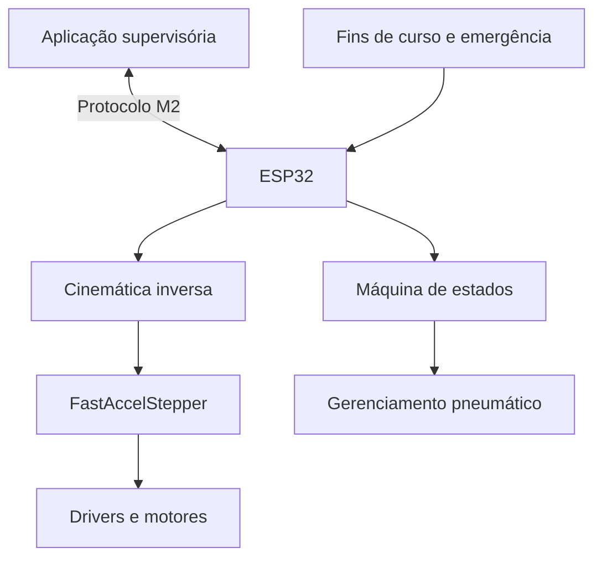

# Projeto Robô Delta — Firmware ESP32

**DELTA CONTROLLER V2.5-M3.9** | Arduino/C++ | Protótipo educacional

## Sobre o projeto

Este firmware integra o Projeto Robô Delta, desenvolvido no contexto de um Trabalho de Conclusão de Curso da Universidade Estadual de Goiás (UEG). O projeto tem como finalidade disponibilizar uma plataforma experimental para o estudo de robótica paralela, sistemas embarcados, automação e operações de Pick and Place.

O ESP32 recebe comandos de uma aplicação supervisória, calcula a cinemática inversa, aciona três motores de passo e gerencia o referenciamento, os estados operacionais e a ferramenta pneumática de coleta. A visão computacional e o planejamento das sequências de coleta e deposição pertencem à aplicação supervisória, não ao firmware.

## 1. Arquivo principal e dependências

- `ESP32_2_M3_9_SUPERVISORY_REARM.ino`: firmware principal.
- Plataforma Arduino para ESP32 (Arduino core).
- Biblioteca [FastAccelStepper](https://github.com/gin66/FastAccelStepper).
- ESP32 compatível com a pinagem indicada, três drivers STEP/DIR, sensores de fim de curso, circuito de emergência e interfaces de acionamento da bomba e da válvula.

As versões exatas do Arduino core e da biblioteca utilizadas na compilação original ainda precisam ser registradas para garantir a reprodutibilidade do ambiente.

## 2. Funcionalidades

- Cinemática inversa do manipulador Delta e conversão de ângulos em pulsos.
- Movimentação articular com velocidades proporcionais aos deslocamentos em passos.
- Homing dos três motores, com busca dos sensores, recuo e definição da referência angular.
- Máquina de oito estados operacionais.
- Comunicação serial estruturada pelo protocolo M2, com identificadores de comandos.
- Consulta de estado e posições angulares estimadas pela contagem de passos.
- Pausa reversível e retomada do movimento estruturado em execução.
- Parada operacional, supervisão da emergência física e rearme pelo supervisório.
- Verificação de limites angulares e monitoramento dos fins de curso durante a movimentação.
- Gerenciamento automático da bomba de vácuo e comando da válvula.

## 3. Arquitetura

O laço principal utiliza rotinas de atualização não bloqueantes para supervisionar a emergência, processar as interfaces seriais, atualizar o homing e a movimentação e aplicar a política pneumática do estado atual. A geração dos pulsos dos motores é delegada à FastAccelStepper.



## 4. Pinagem

| Função | GPIO |
|---|---:|
| Motor 1 STEP / DIR | 33 / 25 |
| Motor 2 STEP / DIR | 16 / 17 |
| Motor 3 STEP / DIR | 4 / 2 |
| Fim de curso X | 34 |
| Fim de curso Y | 35 |
| Fim de curso Z | 32 |
| Emergência física | 19 |
| Válvula de vácuo | 26 |
| Bomba de vácuo | 14 |
| UART2 RX / TX | 22 / 23 |

Os fins de curso são interpretados como acionados em nível HIGH. GPIO34 e GPIO35 requerem pull-up externo; GPIO32 utiliza `INPUT_PULLUP`. A emergência é ativa em LOW, com contato normalmente fechado para 3,3 V e pull-down externo previsto no código. **A constante efetiva da emergência é GPIO19, embora comentários antigos ainda mencionem GPIO21.** As saídas pneumáticas são ativas em HIGH. Utilize interfaces elétricas adequadas às cargas; não alimente motores, bomba ou válvula diretamente pelos GPIOs.

## 5. Parâmetros cinemáticos e operacionais

| Parâmetro | Valor configurado |
|---|---:|
| `f` — dimensão da base | 183 mm |
| `e` — dimensão da plataforma móvel | 63 mm |
| `rf` — comprimento do braço superior | 225 mm |
| `re` — comprimento do braço inferior | 620 mm |
| Limites angulares | −35° a +75° |
| Conversão nominal | 1200 pulsos/volta (0,3°/pulso) |
| Velocidade máxima de operação | 100 pulsos/s |
| Velocidade de homing | 100 pulsos/s |
| Aceleração configurada | 100 pulsos/s² |
| Recuo do homing | 120 pulsos |
| Timeout da busca dos sensores | 5000 ms |
| Filtragem temporal da emergência | 30 ms |

Os valores representam a configuração do software, não uma certificação das dimensões físicas, da precisão ou do espaço de trabalho. O movimento `MOVEJ` é articular; a proporcionalidade das velocidades não garante trajetória cartesiana retilínea nem sincronismo exato de chegada.

## 6. Estados operacionais

| Estado | Descrição | Bomba | Válvula |
|---|---|---|---|
| `NOT_HOMED` | Sem referência operacional válida | OFF | OFF |
| `HOMING` | Busca dos sensores e recuo | OFF | OFF |
| `READY` | Referenciado, disponível para movimento | ON | Preservada |
| `MOVING` | Movimento em execução | ON | Conforme TOOL |
| `PAUSED` | Movimento interrompido temporariamente | ON | Preservada |
| `STOPPED` | Parada operacional | OFF | OFF |
| `EMERGENCY` | Emergência registrada | OFF | OFF |
| `ERROR` | Falha operacional | OFF | OFF |

O fluxo nominal é `NOT_HOMED → HOMING → READY → MOVING → READY`. A pausa preserva o destino do MOVEJ estruturado para retomada. A parada descarta esse contexto. A liberação da emergência não rearma automaticamente o sistema. O procedimento previsto de recuperação é liberar a emergência, executar RESET pelo supervisório e realizar novo HOME.

A política pneumática é aplicada continuamente: em pausa, o comando da válvula é preservado; em parada, emergência ou erro, a bomba e a válvula são desligadas, o que pode liberar uma peça suspensa.

## 7. Comunicação serial — protocolo M2

- Serial principal: 115200 baud; aceita protocolo M2 e comandos legados de bancada.
- UART2: 115200 baud, 8N1; aceita protocolo M2.
- Mensagens textuais terminadas por LF (`\n`); CR é ignorado.
- Identificadores de quatro dígitos, de `0001` a `9999`; `0000` é reservado para erros de enquadramento.
- Buffer de recepção de 192 bytes, compartilhado entre as interfaces.

Formato:

```text
CMD|ID|COMANDO|PARAMETROS
```

| Comando | Finalidade | Exemplo |
|---|---|---|
| STATUS | Consulta sem alterar o estado | `CMD\|0001\|STATUS` |
| RESET | Rearme lógico; invalida a referência | `CMD\|0002\|RESET` |
| HOME | Referenciamento | `CMD\|0003\|HOME` |
| MOVEJ | Movimento para coordenadas X, Y, Z e comando da válvula | `CMD\|0004\|MOVEJ\|0\|0\|-600\|OFF` |
| PAUSE | Pausa de MOVEJ estruturado ativo | `CMD\|0005\|PAUSE` |
| RESUME | Retomada de movimento pausado | `CMD\|0006\|RESUME` |
| STOP | Interrupção de MOVING ou PAUSED | `CMD\|0007\|STOP` |

As coordenadas de MOVEJ são expressas em milímetros; o parâmetro TOOL aceita ON ou OFF (OFF quando omitido). A válvula é comandada antes do início do movimento. MOVEJ exige READY e aprovação das verificações cinemáticas e angulares. Os exemplos de coordenadas são apenas exemplos de sintaxe, não posições verificadas como seguras.

### Respostas

```text
ACK|0001|RECEIVED
STATUS|0001|READY|T1=0.00|T2=0.00|T3=0.00
OK|0001|STATUS
```

Exemplo ilustrativo de consulta após referenciamento. ACK indica recebimento, não conclusão física. OK indica conclusão ou aceitação da operação conforme o comando. ERROR informa rejeição, interrupção ou falha. Nem toda rejeição é precedida por ACK. Também existem eventos STATUS sem identificador e mensagens de diagnóstico na serial principal.

`STATUS` é uma consulta independente da máquina de estados, não uma transição. T1, T2 e T3 são posições calculadas a partir dos contadores de passos, não leituras de encoders.

## 8. Homing e controle de movimento

O homing busca os três sensores individualmente, aguarda a parada dos motores, executa o recuo configurado e zera os contadores. A busca possui timeout. Em MOVEJ, o firmware calcula os três ângulos articulares, verifica os limites, converte os ângulos em passos e envia os destinos à biblioteca de acionamento. Durante MOVING, uma indicação de fim de curso provoca interrupção e estado ERROR.

## 9. Compilação e utilização

1. Instale a Arduino IDE, o suporte a placas ESP32 e a biblioteca FastAccelStepper.
2. Abra o arquivo `.ino` em uma pasta de sketch com o mesmo nome-base do arquivo.
3. Selecione a placa correspondente ao hardware e a porta serial correta.
4. Confira a pinagem, as interfaces elétricas e os parâmetros mecânicos antes de energizar os acionamentos.
5. Compile e grave o firmware. Verifique inicialmente a comunicação com STATUS, mantendo os acionamentos em condição segura.
6. Somente após verificar a instalação, os sensores e a parada independente, realize o referenciamento e os ensaios de movimento sob supervisão.

## 10. Limitações e cuidados de segurança

Este é um protótipo experimental educacional, não um controlador industrial certificado. A parada de hardware pelos terminais ENA dos drivers é descrita no código como independente do firmware; sua implementação elétrica deve ser verificada separadamente.

Pontos de atenção identificados na revisão do código:

- RESET lógico não chama efetivamente `stopAllMotors()` (a chamada está comentada). Não deve ser usado como comando de parada de movimento.
- O HOME legado não aplica todas as verificações do HOME estruturado, inclusive a verificação explícita de emergência ativa. Priorize o protocolo M2 e revise essa compatibilidade antes de uso com acionamentos energizados.
- O HOME estruturado bloqueia emergência ativa, MOVING, HOMING, PAUSED e STOPPED, mas não exige exclusivamente NOT_HOMED. O fluxo de rearme recomendado não é integralmente imposto por todas as rotas de comando.
- Os fins de curso são lidos diretamente, sem filtragem temporal equivalente à da emergência.
- O buffer compartilhado pode exigir revisão para recepção simultânea nas duas interfaces.
- Não há confirmação física da coleta por sensor de vácuo nem realimentação angular por encoder no firmware analisado.

Não opere o manipulador sem proteção adequada, parada física independente e avaliação dos riscos mecânicos e elétricos. Não utilize a pausa ou o RESET como substitutos da parada de emergência.

## 11. Perspectivas de desenvolvimento

- Revisar intertravamentos e consistência dos comandos legados e estruturados.
- Investigar sinalizações indevidas de fim de curso e aprimorar o condicionamento dos sinais.
- Verificar experimentalmente os parâmetros geométricos, a referência angular e a correspondência entre posições comandadas e observadas.
- Aprimorar a validação de parâmetros e o tratamento de falhas de comunicação.
- Incorporar confirmação física da coleta e documentação de atividades didáticas.

## 12. Desenvolvimento e finalidade educacional

O firmware foi desenvolvido com auxílio de ferramentas de inteligência artificial generativa, utilizadas como apoio à elaboração, revisão e aperfeiçoamento do código. A integração com o protótipo, a realização dos ensaios e a avaliação das implementações são de responsabilidade do autor.

A disponibilização do código busca favorecer o estudo, a análise crítica e o aperfeiçoamento de sistemas robóticos. O projeto oferece uma plataforma para explorar cinemática, controle de movimento, comunicação serial, máquinas de estados e integração eletromecânica.

## 13. Licença e contribuição

A licença de distribuição deverá ser definida pelo autor e incluída em um arquivo `LICENSE`. A disponibilização pública do código, por si só, não concede automaticamente permissões de modificação ou redistribuição. As dependências mantêm suas respectivas licenças.

Sugestões de melhorias e relatos de problemas podem ser registrados na seção Issues do repositório, quando habilitada.
