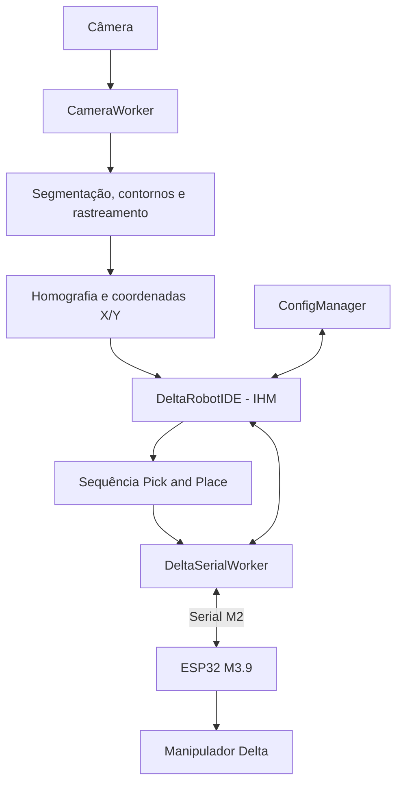
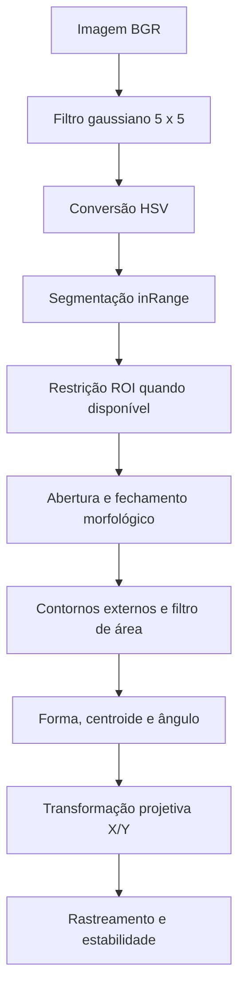

# Projeto Robô Delta — Software Supervisório

**DELTA VISION CONTROL — PC V1.1.0** | Python · PyQt5 · OpenCV | ESP32 M3.9

## Sobre o projeto

O DELTA VISION CONTROL integra o Projeto Robô Delta, desenvolvido no contexto de um Trabalho de Conclusão de Curso da Universidade Estadual de Goiás (UEG). A aplicação constitui uma interface homem-máquina (IHM) para supervisão, configuração e operação experimental de um manipulador paralelo Delta, com finalidade educacional.

O software integra visão computacional, comunicação serial e planejamento de sequências semiassistidas de Pick and Place. O ESP32 permanece responsável pela cinemática inversa, geração dos movimentos, referenciamento e gerenciamento dos estados físicos do manipulador.

## 1. Arquivos e dependências

| Arquivo | Finalidade |
|---|---|
| `delta_ide_v18.py` | Aplicação principal |
| `config_delta.json` | Persistência das configurações locais |
| `matriz_homografia.npy` | Matriz de transformação projetiva salva após calibração |
| `UEG.png` | Logotipo opcional; na ausência, a interface exibe texto alternativo |
| `LICENSE` | Licença MIT do código próprio, a incluir na publicação |

Dependências: Python 3, [PyQt5](https://www.riverbankcomputing.com/software/pyqt/), [OpenCV](https://opencv.org/), [NumPy](https://numpy.org/) e [pySerial](https://pyserial.readthedocs.io/). As versões exatas do ambiente experimental devem ser registradas posteriormente. O código utiliza o backend DirectShow (`CAP_DSHOW`), direcionado ao Windows; outros sistemas operacionais podem exigir adaptação.

## 2. Funcionalidades

- Interface gráfica com monitoramento de conexão, câmera, calibração e estado operacional.
- Aquisição e processamento de imagens em tempo real, visualização da máscara binária e identificação heurística de formas.
- Configuração e persistência de perfis HSV, limites de área e parâmetros de rastreamento.
- Calibração planar por quatro correspondências e transformação de pixels em coordenadas de referência X/Y.
- Rastreamento de objetos com identificadores e critérios de estabilidade.
- Comunicação serial estruturada com o ESP32, console de diagnóstico e tratamento de respostas.
- Comandos HOME, STATUS, MOVEJ, PAUSE, RESUME, STOP e RESET.
- Movimentação manual TEACH/JOG, compensação de offset Z e posição HOLDING.
- Ciclo semiassistido de coleta e deposição de uma peça.
- Manual integrado com pesquisa textual.

## 3. Arquitetura

A interface principal utiliza sinais e slots do Qt para integrar tarefas de comunicação e aquisição de imagens executadas em threads separadas.



| Classe | Responsabilidade |
|---|---|
| `ConfigManager` | Carregar e salvar configurações JSON |
| `DeltaSerialWorker` | Comunicação serial, interpretação de quadros e sinalização à interface |
| `CameraWorker` | Captura, processamento, homografia e rastreamento |
| `ClickableVideoLabel` | Captura de cliques para calibração |
| `DeltaRobotIDE` | Interface, comandos, validações e coordenação de ciclos |
| `Kalman2D` | Classe auxiliar definida no código, não utilizada pelo rastreamento principal |

## 4. Interface gráfica

| Página | Função |
|---|---|
| HOME | Visão geral da aplicação |
| VISÃO | Imagem e máscara do processamento |
| CALIBRAÇÃO | Seleção dos quatro pontos e cálculo da homografia |
| CORES | Ajuste HSV, área e perfis |
| FILA | Tabela de objetos rastreados e parâmetros de estabilidade |
| TEACH / JOG | Controle manual, conexão, offset, HOLDING e Pick and Place |
| MANUAL | Guia integrado de operação |
| DIAGNÓSTICO | Console e diagnóstico |
| REGRAS, DESTINOS, MÉTRICAS | Páginas reservadas para desenvolvimento futuro |

A presença de páginas reservadas não significa que classificação automática por destino, filas de execução multipeça ou coleta automática de métricas estejam implementadas.

## 5. Visão computacional

A câmera é aberta com resolução solicitada de 640 × 480 pixels. A resolução efetiva depende do dispositivo.



| Operação | Função OpenCV |
|---|---|
| Captura | `VideoCapture` |
| Suavização | `GaussianBlur` |
| Conversão de cor | `cvtColor` |
| Segmentação HSV | `inRange` |
| Máscara poligonal | `fillPoly`, `bitwise_and` |
| Morfologia | `morphologyEx` |
| Contornos e área | `findContours`, `contourArea` |
| Aproximação poligonal | `arcLength`, `approxPolyDP` |
| Classificação geométrica | `boundingRect` |
| Centroide | `moments` |
| Orientação estimada | `minAreaRect` |
| Homografia | `findHomography`, `perspectiveTransform` |

A classificação é heurística: três vértices indicam triângulo; quatro indicam quadrado ou retângulo conforme a proporção do retângulo delimitador; mais de quatro são classificados como círculo. Isso não constitui reconhecimento robusto de formas arbitrárias. O ângulo estimado não representa um eixo de rotação comandado do efetuador.

## 6. Calibração visual

1. Fixe a câmera em relação à superfície de trabalho.
2. Defina quatro referências coplanares, não degeneradas, com coordenadas X/Y conhecidas no sistema de referência adotado.
3. Na página CALIBRAÇÃO, selecione os quatro pontos correspondentes na imagem, na mesma ordem das coordenadas configuradas.
4. Calcule a homografia. A matriz é salva em `matriz_homografia.npy`.
5. Verifique a correspondência em pontos adicionais antes de movimentar o robô.

A transformação converte centroides em coordenadas X/Y por `perspectiveTransform`. A ROI visual restringe a detecção quando os pontos correspondentes estão disponíveis. Refaça a calibração se a câmera ou o plano de trabalho mudar.

No protótipo experimental, referências físicas alcançadas pelo manipulador foram utilizadas para adaptar a correspondência visual aos comandos do robô. Essa estratégia não corrige a cinemática nem comprova exatidão métrica. Não se trata de calibração intrínseca da câmera ou reconstrução tridimensional.

## 7. Rastreamento

A associação entre detecções e objetos existentes utiliza distância entre centroides, compatibilidade de forma e tolerância de área. Os candidatos são ordenados por uma pontuação de associação. Não há predição de trajetória por Kalman no fluxo principal.

| Estado visual | Significado |
|---|---|
| `DETECTED` | Objeto identificado, ainda sem estabilidade suficiente |
| `STABLE` | Objeto que atende ao critério de estabilidade em quadros consecutivos |
| `LOST` | Objeto temporariamente ausente, mantido em memória por uma janela configurável |

Parâmetros iniciais: 8 quadros estáveis, distância de associação de 55 px, deslocamento estável de até 7 px, recuperação de 90 px, tolerância de área de 45% e até 30 quadros perdidos. São valores configuráveis, não resultados de validação metrológica.

## 8. Comunicação serial e estados

A comunicação usa 115200 bps e quadros ASCII terminados por nova linha, com identificadores de 0001 a 9999.

```text
CMD|0001|STATUS
CMD|0002|HOME
CMD|0003|MOVEJ|X|Y|Z|ON/OFF
```

O último exemplo representa a sintaxe, não um comando executável com coordenadas reais. O worker registra as mensagens recebidas e interpreta `STATUS`, `OK`, `ERROR` e eventos de emergência. `ACK` pode aparecer no console, mas não é a confirmação de conclusão usada para avançar a sequência. O avanço depende do `OK` correspondente ao MOVEJ e do estado READY.

| Comando | Finalidade |
|---|---|
| STATUS | Consultar estado, sem provocar transição operacional |
| HOME | Referenciar o manipulador |
| MOVEJ | Solicitar movimento e estado da ferramenta |
| PAUSE / RESUME | Pausar / retomar movimento |
| STOP | Solicitar parada operacional |
| RESET | Solicitar rearme lógico conforme condições do firmware |

Estados do firmware: `NOT_HOMED`, `HOMING`, `READY`, `MOVING`, `PAUSED`, `STOPPED`, `EMERGENCY`, `ERROR`. A IHM também representa condições de comunicação e recuperação, como `DESCONECTADO`, `CONECTADO`, `RESTARTING` e `EMERGENCY_RELEASED`. Estas não devem ser confundidas com estados adicionais do enum do firmware.

## 9. TEACH/JOG e proteção supervisória

O JOG é liberado em READY. A referência cartesiana é atualizada após a confirmação do movimento, não por medição física da posição. A interface converte a magnitude positiva de Z digitada em coordenada negativa e aplica o offset da ferramenta:

`Z_base = Z_ferramenta + offset_Z`

O software verifica X/Y na faixa de edição de -500 a +500 mm, Z da ponta não positivo, limite mínimo configurado da ponta e Z da base entre -800 e 0 mm. Essas faixas não definem o espaço de trabalho real nem garantem ausência de colisões. A posição HOLDING pode retirar o manipulador do campo visual da câmera.

## 10. Pick and Place semiassistido

A captura exige exatamente um objeto STABLE com coordenadas X/Y disponíveis. O alvo é congelado pelo operador. O início do ciclo exige READY e novamente um único objeto estável válido; o código não garante que esse objeto seja o mesmo ID capturado.

| Etapa | Operação | Ferramenta |
|---:|---|---|
| 1 | Aproximar PICK | OFF |
| 2 | Descer PICK | OFF |
| 3 | Acionar ferramenta | ON |
| 4 | Subir PICK | ON |
| 5 | Ir sobre DROP | ON |
| 6 | Descer DROP | ON |
| 7 | Desativar ferramenta | OFF |
| 8 | Subir DROP | OFF |
| 9 | Retornar a HOLDING | OFF |

Os alvos são verificados antes do ciclo. Cada etapa é enviada como MOVEJ, aguardando a confirmação correspondente. Erros e estados de bloqueio cancelam a sequência. A conclusão lógica não confirma fisicamente a coleta ou deposição; não há realimentação de presença da peça nesse fluxo. A sequência é de uma peça por acionamento, não uma operação autônoma contínua.

## 11. Instalação e primeiros passos

Em um terminal Windows, no diretório do software:

```powershell
python -m venv .venv
.\.venv\Scripts\Activate.ps1
python -m pip install PyQt5 opencv-python numpy pyserial
python delta_ide_v18.py
```

Esses comandos são uma proposta de instalação; as versões das dependências não foram congeladas nem a instalação reexecutada nesta revisão.

Com o hardware em condições seguras, selecione a câmera, ajuste a segmentação, configure as referências de calibração e confira os parâmetros físicos. Conecte o ESP32 via USB, use SCAN, selecione a porta correta e conecte. Aguarde a sincronização inicial, consulte STATUS e realize HOME quando necessário. Aguarde READY. Valide os limites e os alvos com supervisão antes de qualquer ciclo. Não utilize valores padrão como garantia de compatibilidade mecânica.

## 12. Limitações, segurança e trabalhos futuros

- Protótipo experimental, sem certificação de segurança industrial. A IHM e suas confirmações não substituem dispositivos físicos de proteção.
- O firmware é a autoridade sobre cinemática e execução física; não há garantia de que um comando transmitido seja executado corretamente.
- O código atual contém tratamento de exceções de abertura, leitura e escrita serial. A robustez precisa ser verificada em testes de desconexão e reconexão; não se presume que falhas históricas tenham sido eliminadas.
- O manual interno menciona GPIO21 para emergência, mas a constante efetiva do firmware M3.9 é GPIO19. Corrigir essa divergência documental antes da publicação.
- A homografia é planar; variações de altura, iluminação, oclusão e distorção óptica podem afetar a detecção e a localização.
- O rastreamento não garante identidade persistente em cruzamentos ou oclusões prolongadas.
- Trabalhos futuros: confirmação física da coleta, validação espacial, tratamento de falhas e reconexão, regras de classificação e destinos, métricas experimentais e fixação das versões de dependências.

## 13. Desenvolvimento e finalidade educacional

O desenvolvimento da aplicação contou com auxílio de ferramentas de inteligência artificial generativa na elaboração, revisão e aperfeiçoamento do código. A definição dos requisitos, integração com o protótipo, realização dos ensaios e análise dos resultados permaneceram sob responsabilidade do autor.

A disponibilização do software busca apoiar o estudo de interfaces gráficas, sistemas concorrentes, comunicação serial, processamento de imagens, geometria projetiva, máquinas de estados e integração de sistemas robóticos. A finalidade educacional não equivale à comprovação experimental de eficácia pedagógica.

## 14. Licença e contribuição

Licença escolhida: MIT. Após a inclusão do arquivo [LICENSE](LICENSE), o código próprio poderá ser utilizado, reproduzido, estudado, modificado e redistribuído, inclusive comercialmente, mediante preservação dos avisos de direitos autorais e dos termos da licença.

O software é fornecido sem garantias, em sua natureza experimental e educacional. Contribuições, correções e propostas de aperfeiçoamento são bem-vindas.

A licença MIT do código próprio não altera as licenças das dependências. Verifique especialmente os termos GPL/comerciais do PyQt5 ao distribuir a aplicação, além dos direitos de uso do logotipo institucional e demais materiais de terceiros. A publicação deve respeitar as regras de propriedade intelectual aplicáveis à UEG.

## Documentação técnica complementar

- [OpenCV — documentação](https://docs.opencv.org/4.x/)
- [PyQt5 — documentação](https://www.riverbankcomputing.com/static/Docs/PyQt5/)
- [NumPy — documentação](https://numpy.org/doc/)
- [pySerial — documentação](https://pyserial.readthedocs.io/)
- [MIT License — Open Source Initiative](https://opensource.org/license/mit)
